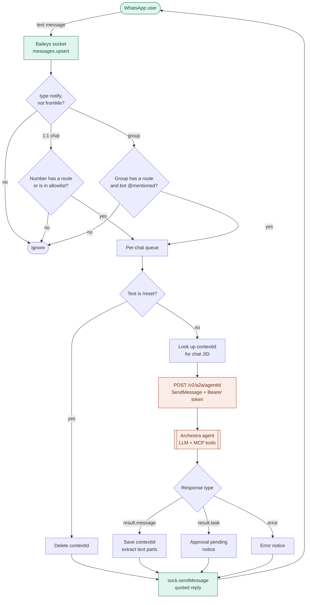
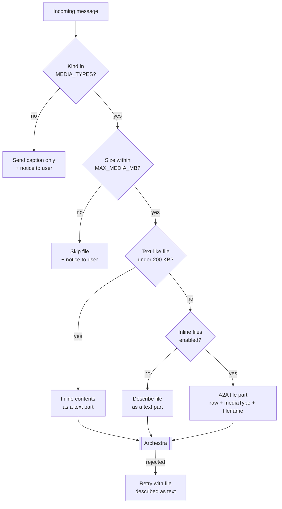

# baileys-archestra-a2a

Talk to an [Archestra](https://github.com/archestra-ai/archestra) AI agent from WhatsApp.

Archestra has no native WhatsApp channel, but every agent can be invoked through its **Webhook (A2A)** trigger. This bridge uses [Baileys](https://github.com/WhiskeySockets/Baileys) to log in as a linked WhatsApp device, forwards incoming messages to `POST /v2/a2a/{agentId}` as A2A `SendMessage` calls, and sends the agent's reply back to the chat. Each WhatsApp chat keeps its own multi-turn conversation in Archestra.

## Flow



## Requirements

- Node.js 22+
- A running Archestra platform and an agent with the Webhook (A2A) trigger available
- An Archestra token (personal, team or organization) that has access to that agent
- A WhatsApp account to link as a device. Use a dedicated number (see [Caveats](#caveats)).

## Quick start

```bash
git clone https://github.com/pushm0v/baileys-archestra-a2a
cd baileys-archestra-a2a
npm install
cp .env.example .env   # fill in ARCHESTRA_URL, ARCHESTRA_AGENT_ID, ARCHESTRA_TOKEN, ALLOWED_NUMBERS
npm start
```

A QR code prints in the terminal on first run. On the phone, open WhatsApp → **Linked devices** → **Link a device** and scan it. Credentials are saved in `data/auth`, so later runs reconnect without scanning.

Send the linked number a message from an allowlisted phone and the agent replies in the chat. Send `/reset` to start a fresh conversation.

## Configuration

| Variable | Required | Default | Description |
| --- | --- | --- | --- |
| `ARCHESTRA_URL` | yes | | Base URL of the Archestra platform, backend port 9000, e.g. `http://archestra:9000` |
| `ARCHESTRA_AGENT_ID` | yes | | ID of the agent to invoke |
| `ARCHESTRA_TOKEN` | yes | | Archestra token with access to the agent |
| `ALLOWED_NUMBERS` | no | empty (anyone) | **Direct chats only.** Comma-separated phone numbers with country code, no `+`. Has no effect in groups; see [Who can use the bot](#who-can-use-the-bot) |
| `DATA_DIR` | no | `./data` | Stores WhatsApp session (`auth/`) and the chat → `contextId` map |
| `AGENT_TIMEOUT_MS` | no | `300000` | Max wait for a synchronous agent reply |
| `LOG_LEVEL` | no | `warn` | Baileys log level |
| `MEDIA_TYPES` | no | `image,document` | Attachment kinds to forward: `image`, `document`, `audio`, `video`, `sticker` |
| `MAX_MEDIA_MB` | no | `10` | Largest attachment to forward |
| `MEDIA_INLINE` | no | `auto` | `auto`, `always` or `never`. See [Media forwarding](#media-forwarding) |
| `ROUTES_FILE` | no | `$DATA_DIR/routes.json` | Group / number → agent routes. See [Groups and routing](#groups-and-routing) |

## Groups and routing

Each WhatsApp group can be bound to its own Archestra agent with a routes file (JSON). Groups without a route are ignored, and direct chats without a route keep going to `ARCHESTRA_AGENT_ID`.

```json
{
  "120363041234567890@g.us": { "name": "ops", "agentId": "5650c819-345a-4d05-82f7-b901ba5dba1f" },
  "120363049876543210@g.us": {
    "name": "sales",
    "agentId": "9a1b…",
    "url": "https://other-archestra.example.com",
    "token": "env:SALES_TOKEN",
    "trigger": "mention",
    "allowedNumbers": ["6281234567890"]
  },
  "6281234567890": { "agentId": "…" }
}
```

| Field | Default | Description |
| --- | --- | --- |
| key | | Group JID (`…@g.us`), or a phone number for direct chats from that number |
| `agentId` | required | Agent to invoke |
| `name` | the key | Label used in logs |
| `url` | `ARCHESTRA_URL` | Archestra backend for this agent |
| `token` | `ARCHESTRA_TOKEN` | Token for this agent. `env:NAME` reads it from environment variable `NAME` |
| `trigger` | `mention` | Groups only. `mention`: answer only when the bot is @mentioned. `all`: answer every message |
| `allowedNumbers` | any member | Groups only. Members allowed to use the agent |

- **Passive by default.** In a group the bot only answers messages that @mention it; the mention itself is stripped before the text goes to the agent.
- **Finding a group's JID.** The first message from an unmapped group logs `unmapped group 1203…@g.us "Group name"`. You can also send `@bot /chatid` in the group (or `/chatid` in a direct chat) and the bot replies with the key to use.
- **One conversation per group.** Members share the group's Archestra conversation, and each message is prefixed with the sender (`[Budi (62812…)]: …`) so the agent knows who is talking. `@bot /reset` starts a new one.
- Routes are read at startup; restart the bridge after changing them. With Docker Compose and `BRIDGE_DATA=./data`, put the file at `./data/routes.json`. With Helm, set `routes:` in your values.

### Who can use the bot

`ALLOWED_NUMBERS` only controls **direct chats**. Groups are controlled per route in the routes file, so adding the bot to a group does not let anyone in until that group has a route, and once it has one, `ALLOWED_NUMBERS` does not apply there.

| Chat | Who gets an answer |
| --- | --- |
| Direct chat, number has no route | Numbers in `ALLOWED_NUMBERS` (anyone, if it is empty) |
| Direct chat, number has its own route | That number, even if it is not in `ALLOWED_NUMBERS` |
| Group without a route | Nobody. The bot stays silent and logs the group JID once. Only `@bot /chatid` gets a reply, from any member |
| Routed group without `allowedNumbers` | **Every member** who @mentions the bot (or every message, with `trigger: "all"`) |
| Routed group with `allowedNumbers` | Only the listed members; others are ignored without a reply and logged as `sender X is not in allowedNumbers` |

Anyone added to a routed group can use its agent on your Archestra token, so set `allowedNumbers` on routes for groups whose membership you don't control:

```json
{
  "120363041234567890@g.us": {
    "name": "ops",
    "agentId": "5650c819-345a-4d05-82f7-b901ba5dba1f",
    "allowedNumbers": ["6281234567890", "6289876543210"]
  }
}
```

If a listed member is still dropped, check the number in the `sender X is not in allowedNumbers` log line. When WhatsApp only shares a member's LID (a hidden ID instead of the phone number) and the bridge has no mapping for it yet, X is that long LID; add it to the list as well.

## Many numbers: dashboard and runners

To run several WhatsApp numbers and manage them from a web page, deploy the dashboard in [`dashboard/`](dashboard/README.md) to Cloudflare Workers (admins sign in with Google) and run one or more **runners** on your own servers:

```bash
node src/runner.mjs   # or: docker compose --profile runner up -d runner, or Helm with mode=runner
```

A runner starts one bridge process per number assigned to it, dials out to the dashboard (no open ports), and shows each number's QR code, status and logs there. Archestra tokens stay on the runner as env vars; the dashboard only stores their names. See [dashboard/README.md](dashboard/README.md) for setup.

The single-number setup below keeps working unchanged.

## Docker Compose

`docker-compose.yml` runs the bridge, and optionally Archestra itself.

```bash
cp .env.example .env        # set ARCHESTRA_AGENT_ID, ARCHESTRA_TOKEN, ALLOWED_NUMBERS, ARCHESTRA_URL

# Option A: bridge + Archestra on this host
docker compose --profile archestra up -d
# Option B: bridge only, pointing at an existing Archestra
docker compose up -d

docker compose logs -f bridge   # scan the QR code: WhatsApp > Linked devices > Link a device
```

Set `ARCHESTRA_URL` to Archestra's **backend** (port 9000, where `/v2/a2a` lives), not the UI on 3000:

| Where Archestra runs | `ARCHESTRA_URL` |
| --- | --- |
| Same compose project (`--profile archestra`) | `http://archestra:9000` |
| Docker on the same host, separate project | `http://host.docker.internal:9000` |
| Remote server behind a reverse proxy | `https://archestra.example.com` (with `/v2` routed to port 9000) |

With option A, open <http://localhost:3000>, create the agent and a token, put them in `.env`, then run `docker compose up -d bridge` to restart the bridge with the new values.

The WhatsApp session and conversation map live in the `bridge-data` volume, so restarts and image rebuilds don't need a new QR scan. To re-pair, run `docker compose down` then `docker volume rm <project>_bridge-data`. To keep this data in a host folder instead, set `BRIDGE_DATA=./data` in `.env` (re-pair by deleting `./data/auth`).

### Archestra behind a private CA

If the bridge logs `agent call failed: fetch failed (UNABLE_TO_GET_ISSUER_CERT_LOCALLY)` or `(SELF_SIGNED_CERT_IN_CHAIN)`, Archestra's certificate is signed by a CA the container doesn't trust (the host may trust it through its own keychain). Put the CA certificate(s) in PEM form in `./certs`, set `NODE_EXTRA_CA_CERTS=/certs/ca.pem` in `.env`, then run `docker compose up -d bridge`. On macOS you can export a CA from Keychain with:

```bash
mkdir -p certs && security find-certificate -a -c "<CA common name>" -p > certs/ca.pem
```

Updating after a `git pull`:

```bash
docker compose build bridge && docker compose up -d bridge
```

## Kubernetes (Helm)

The chart in `charts/baileys-archestra-a2a` runs the bridge as a single-replica Deployment (one WhatsApp session can only be driven by one process) with a PersistentVolumeClaim for the session. Build and push the image to a registry your cluster can pull from, then:

```bash
helm install whatsapp charts/baileys-archestra-a2a -n whatsapp --create-namespace \
  --set image.repository=<registry>/baileys-archestra-a2a --set image.tag=<tag> \
  --set archestra.url=https://archestra.example.com \
  --set archestra.agentId=<agent-id> \
  --set archestra.token=<token> \
  --set 'allowedNumbers={6281234567890}'

kubectl logs -f -n whatsapp deploy/whatsapp-baileys-archestra-a2a   # scan the QR code
```

- Token from a Secret you manage: `--set archestra.existingSecret=<name>` (key `token`, or set `archestra.existingSecretKey`).
- Archestra behind a private CA: `--set-file caBundle.pem=certs/ca.pem`, or reference an existing ConfigMap/Secret with `caBundle.existingConfigMap` / `caBundle.existingSecret`.
- The PVC is kept on `helm uninstall` (deleting it logs the session out). To re-pair, `rm -rf /data/auth` in the pod and restart it.

See `charts/baileys-archestra-a2a/values.yaml` for all options.

## How it works

**Calling the agent.** Each message becomes an A2A JSON-RPC request:

```json
{
  "jsonrpc": "2.0",
  "id": 1,
  "method": "SendMessage",
  "params": {
    "message": {
      "messageId": "<uuid>",
      "role": "ROLE_USER",
      "contextId": "<omitted on first message>",
      "parts": [{ "text": "Hello agent" }]
    }
  }
}
```

**Conversation memory.** Archestra generates `contextId` on the first message and callers can't choose their own, so the bridge stores a map of WhatsApp chat JID → `contextId` in `data/contexts.json` and sends it on every later turn.

**Ordering.** Messages are queued per chat, so a fast second message waits for the first reply instead of racing on the same context.

**Approvals.** If a tool call hits an Archestra policy that requires human approval, the response is a `task` in `TASK_STATE_INPUT_REQUIRED` instead of a message. The bridge tells the user approval is pending. Approve it in Archestra, or extend the bridge to send `metadata.taskOps.approvalDecisions` back.

**Filtering.** Only new 1:1 messages are forwarded. Groups, channels, status updates, history sync and your own messages are ignored.

## Media forwarding

Attachments are downloaded with Baileys and sent to the agent alongside the caption:



- **Captions** become the text part. With no caption, the agent gets a line like `(The user sent an image: image-ABC.jpg)`.
- **Text-like files** (`text/*`, JSON, XML, CSV, YAML) under 200 KB are inlined as text, which every model can read.
- **Other files** (images, PDFs, audio, video) are sent as A2A 1.0 file parts, with bytes base64-encoded in JSON:

  ```json
  { "raw": "<base64>", "mediaType": "image/jpeg", "filename": "image-ABC.jpg" }
  ```

- Wrapped messages (view-once, disappearing, document-with-caption) are unwrapped first. Voice notes arrive as `audio/ogg`.
- Whether the model can actually use an image, PDF or audio file depends on the LLM behind your Archestra agent.

### Inline file support and `MEDIA_INLINE`

Archestra's agent runtime accepts file parts (`raw` + `mediaType` + `filename`), but at the time of writing its v2 HTTP endpoint validates `raw` as a byte array, which plain JSON can't carry. Depending on your Archestra version, a file part over HTTP may be rejected as invalid params. The bridge handles this:

| Mode | Behaviour |
| --- | --- |
| `auto` (default) | Tries a file part. If Archestra rejects it (HTTP 400/422 or JSON-RPC `-32600`/`-32602`), resends with the file described as text, tells the user, and describes files as text for the rest of the process lifetime. A 413 (too large) falls back for that message only. |
| `always` | Tries a file part every time, falling back per message. |
| `never` | Never sends bytes. Binary files are described as text, and only text-like files are inlined. |

If your Archestra version accepts base64 `raw` over HTTP, `auto` simply keeps sending files. Archestra's default request body limit is 70 MB (`ARCHESTRA_API_BODY_LIMIT`); base64 adds about a third to file size.

## Tests

```bash
npm test
```

The tests cover message parsing, media part building and the Archestra client (context memory and file-part fallback) against a mock A2A server. They don't need WhatsApp or a real Archestra.

## Caveats

- Baileys is an unofficial WhatsApp Web client. Automating a personal account may violate WhatsApp's Terms of Service and can get the number banned. Use a dedicated number.
- Don't run Baileys on a number that is also connected to the official WhatsApp Business Cloud API; incoming messages may fail to decrypt.
- Messages run under your Archestra token(s). Keep `ALLOWED_NUMBERS` set so strangers can't use your agent or your LLM budget, and only route groups whose members you trust (or set `allowedNumbers` on the route).
- Agent calls are synchronous. Very long agent runs can hit `AGENT_TIMEOUT_MS`.

## Ideas for extension

- Transcribe voice notes before sending, for models without audio input
- Send the agent's file parts back to WhatsApp as media
- Approve or reject pending tool calls from WhatsApp
- Route by keyword (e.g. `/sales …`) to different agents
- Reload the routes file without a restart
- Move `contexts.json` to Redis or Postgres for multi-instance deployments

## References

- [Archestra agent triggers (Schedule, Webhook/A2A, Email)](https://mintlify.wiki/archestra-ai/archestra/agents/triggers)
- [Baileys documentation](https://baileys.whiskeysockets.io/)
- [A2A protocol](https://a2a-protocol.org/)

## License

MIT
