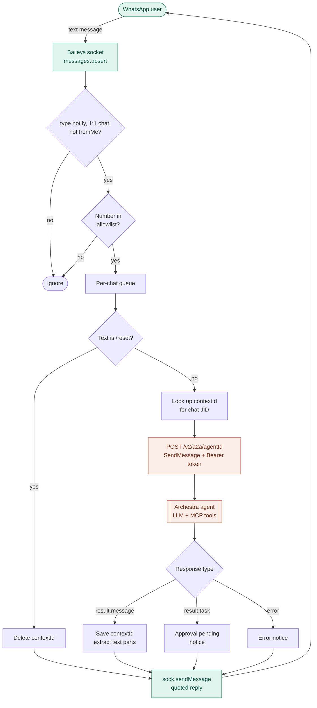

# baileys-archestra-a2a

Talk to an [Archestra](https://github.com/archestra-ai/archestra) AI agent from WhatsApp.

Archestra has no native WhatsApp channel, but every agent can be invoked through its **Webhook (A2A)** trigger. This bridge uses [Baileys](https://github.com/WhiskeySockets/Baileys) to log in as a linked WhatsApp device, forwards incoming messages to `POST /v2/a2a/{agentId}` as A2A `SendMessage` calls, and sends the agent's reply back to the chat. Each WhatsApp chat keeps its own multi-turn conversation in Archestra.

## Flow



## Requirements

- Node.js 22+
- A running Archestra platform and an agent with the Webhook (A2A) trigger available
- An Archestra token (personal, team or organization) that has access to that agent
- A WhatsApp account to link as a device. Use a dedicated number (see [Caveats](#caveats)).

## Quick start

```bash
git clone https://github.com/pushm0v/baileys-archestra-a2a
cd baileys-archestra-a2a
npm install
cp .env.example .env   # fill in ARCHESTRA_URL, ARCHESTRA_AGENT_ID, ARCHESTRA_TOKEN, ALLOWED_NUMBERS
npm start
```

A QR code prints in the terminal on first run. On the phone, open WhatsApp → **Linked devices** → **Link a device** and scan it. Credentials are saved in `data/auth`, so later runs reconnect without scanning.

Send the linked number a message from an allowlisted phone and the agent replies in the chat. Send `/reset` to start a fresh conversation.

## Configuration

| Variable | Required | Default | Description |
| --- | --- | --- | --- |
| `ARCHESTRA_URL` | yes | | Base URL of the Archestra platform, e.g. `http://localhost:3000` |
| `ARCHESTRA_AGENT_ID` | yes | | ID of the agent to invoke |
| `ARCHESTRA_TOKEN` | yes | | Archestra token with access to the agent |
| `ALLOWED_NUMBERS` | no | empty (anyone) | Comma-separated phone numbers with country code, no `+` |
| `DATA_DIR` | no | `./data` | Stores WhatsApp session (`auth/`) and the chat → `contextId` map |
| `AGENT_TIMEOUT_MS` | no | `300000` | Max wait for a synchronous agent reply |
| `LOG_LEVEL` | no | `warn` | Baileys log level |

## Docker

```bash
docker build -t baileys-archestra-a2a .
docker run -it --env-file .env -v baileys-data:/data baileys-archestra-a2a
```

Run interactively (`-it`) the first time so you can scan the QR code. If Archestra runs in Docker on the same host, put both containers on one network and point `ARCHESTRA_URL` at the Archestra container name.

## How it works

**Calling the agent.** Each message becomes an A2A JSON-RPC request:

```json
{
  "jsonrpc": "2.0",
  "id": 1,
  "method": "SendMessage",
  "params": {
    "message": {
      "messageId": "<uuid>",
      "role": "ROLE_USER",
      "contextId": "<omitted on first message>",
      "parts": [{ "text": "Hello agent" }]
    }
  }
}
```

**Conversation memory.** Archestra generates `contextId` on the first message and callers can't choose their own, so the bridge stores a map of WhatsApp chat JID → `contextId` in `data/contexts.json` and sends it on every later turn.

**Ordering.** Messages are queued per chat, so a fast second message waits for the first reply instead of racing on the same context.

**Approvals.** If a tool call hits an Archestra policy that requires human approval, the response is a `task` in `TASK_STATE_INPUT_REQUIRED` instead of a message. The bridge tells the user approval is pending. Approve it in Archestra, or extend the bridge to send `metadata.taskOps.approvalDecisions` back.

**Filtering.** Only new 1:1 text messages are forwarded. Groups, channels, status updates, history sync and your own messages are ignored. Image and video captions are forwarded as text; media itself is not.

## Caveats

- Baileys is an unofficial WhatsApp Web client. Automating a personal account may violate WhatsApp's Terms of Service and can get the number banned. Use a dedicated number.
- Don't run Baileys on a number that is also connected to the official WhatsApp Business Cloud API; incoming messages may fail to decrypt.
- All messages run under one Archestra token. Keep `ALLOWED_NUMBERS` set so strangers can't use your agent or your LLM budget.
- Agent calls are synchronous. Very long agent runs can hit `AGENT_TIMEOUT_MS`.

## Ideas for extension

- Forward images as A2A file parts using Baileys `downloadMediaMessage`
- Approve or reject pending tool calls from WhatsApp
- Route different numbers or keywords to different agents
- Move `contexts.json` to Redis or Postgres for multi-instance deployments

## References

- [Archestra agent triggers (Schedule, Webhook/A2A, Email)](https://mintlify.wiki/archestra-ai/archestra/agents/triggers)
- [Baileys documentation](https://baileys.whiskeysockets.io/)
- [A2A protocol](https://a2a-protocol.org/)

## License

MIT
